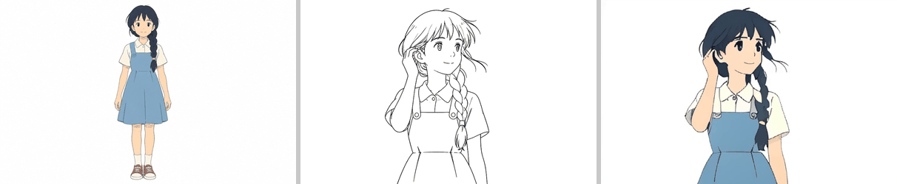
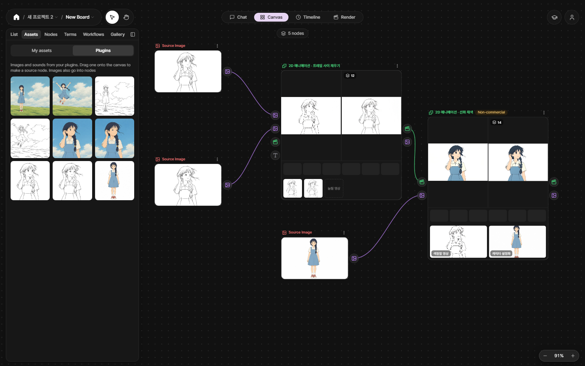

<!-- version: 1.0.0 | lastUpdated: 2026-10-31 -->
# 2D Animation Pack — Line Art Colorization (AniDoc)

[한국어](README.md)

A PromBoard community plugin. It turns a line-art video (or a color video) into **a video colored with the colors of one character design sheet**. It runs the open model [AniDoc](https://github.com/yihao-meng/AniDoc) (CVPR 2025) on your own PC.

The 2D Animation Pack is split into three cards because their licenses differ.

| Card | What it does |
|---|---|
| [2D Animation Pack — Fill Between Frames](https://github.com/promboard-app/anime2d) | Fills the frames between two keyframes, raises the frame rate of a video |
| **2D Animation Pack — Line Art Colorization** (this repository) | Colors a line-art video with the colors of a character design sheet |
| [2D Animation Pack — Colored Video from Keyframes](https://github.com/promboard-app/anime2d-tooncomposer) | Makes a colored video from a few keyframes (server-class GPU) |

> Windows and Linux only (no macOS). This card needs an NVIDIA graphics card.

The line-art video in the middle is colored with the colors of the design sheet on the left (result on the right). The middle video is the two example line-art frames joined into 14 frames by the pack card's "two frames → in-between frames"; everything comes from running the example workflow below in the app (seed 1).

## How to use it

1. PromBoard app → Plugin Manager → **Community plugins**, install this card. You must read and tick the license notice (non-commercial) to install it.
2. It contains code, so turn **Restricted mode** off and enable the plugin.
3. On the first run, Prepare downloads the models and Python packages (once, see the table below).
4. Start one of two ways.
   - **Try the example**: on the canvas, press [Load workflow] and pick "이어진 선화 두 장 → 중간 프레임 → 선화 채색" under Plugins. From the left panel, Assets › Plugins, drag the example cards onto the source nodes (connected line-art start and end frames → the two sources on the left, character design sheet → the source at the bottom). Press ▷ on the "프레임 사이 채우기" node, then on the "선화 채색" node. The workflow also uses the pack card "Fill Between Frames"; if it is missing, "Install missing plugins" gets it.
   - **If you already have a line-art video**: put a Source Video node (line-art video) and a Source Image node (character design sheet) on the canvas and connect them straight to the **2D 애니메이션 · 선화 채색** node. The pack card is not needed.

The app after running the example workflow. The left panel shows the example cards; the node on the far right is this card (note the "Non-commercial" pill).

## Inputs and outputs

| | |
|---|---|
| Inputs | Video to color (line-art or color video) · one character design sheet |
| Outputs | Colored video (fit inside 512×320, keeps the input aspect ratio and fps, no audio) and its frames (when the video has 64 frames or fewer) |
| Download | Models 10.6 GB + Python packages (with torch, about 6.6 GB installed). First time only |
| GPU memory | NVIDIA, 8 GB or more. On a 12 GB card it peaked at 6.6 GB and still ran when capped at 7 GB. Below 16 GB, idle parts wait in system RAM |
| Time | 14 frames: about 1 min 30 s on the first run (includes loading the models), then about 21 s. 98 frames about 2 min 40 s, 240 frames about 6 min 30 s (RTX 4070 SUPER 12 GB) |
| Length | Up to 240 frames (10 seconds at 24 fps). After the first 14 frames, it stops right away and tells you if this PC cannot finish in time |

- AniDoc colors 14 frames at a time. Longer videos are colored 14 frames at a time and joined. Colors can shift slightly where one batch meets the next.
- 16:10 landscape (512×320) works best. Other aspect ratios are padded with white, colored, and the padding is cropped off again.
- The best design sheet shows the character large, from the front, with flat colors. The line art and the sheet must show the same character for the colors to match.

### Settings

| Setting | Options | Meaning |
|---|---|---|
| 색칠할 영상 종류 (video type) | 컬러 영상 (color video, extract lines first) · 선화 영상 (line-art video, use as is) | Color video (default): extracts the lines again from every frame before coloring. Line-art videos work too. Line-art video: uses the black-on-white lines as they are, keeping the original lines. Coloring a color video this way breaks it |
| 시드 (seed) | integer (-1 = different every time) | Same seed and inputs give the same result. Colors change a lot between seeds (the braid or shirt color can change); if you do not like the result, change only the seed and run again |

## Going further

- **Longer**: color the scene in several cuts and join them in the Render tab.
- **Smoother**: connect the result to the pack card's "Video → more frames" to raise the fps 2–3×.
- **Bigger**: the result is 512×320. Upscale it with the SeedVR2 upscale plugin.

## Can I use it this way?

| Card | License | Selling, ads, paid services (commercial use) |
|---|---|---|
| Fill Between Frames | Apache-2.0 · MIT ([repository](https://github.com/promboard-app/anime2d)) | Yes |
| **Line Art Colorization (this card)** | Point tracking CoTracker [CC-BY-NC-4.0](https://github.com/facebookresearch/co-tracker/blob/main/LICENSE.md) · keypoints SuperPoint [Magic Leap non-commercial license](https://github.com/magicleap/SuperPointPretrainedNetwork/blob/master/LICENSE) · coloring model [Stability AI Community License](https://huggingface.co/stabilityai/stable-video-diffusion-img2vid-xt/blob/9e43909513c6714f1bc78bcb44d96e733cd242aa/LICENSE.md) | **No** (non-commercial) |
| Colored Video from Keyframes | See that repository's README | See that repository's README |

- PromBoard marks every result that went through the colorization node as "Non-commercial".
- The coloring model AniDoc is a fine-tune of Stable Video Diffusion, so the Stability AI Community License applies too (commercial use only under USD 1M annual revenue, registration with Stability AI, "Powered by Stability AI" attribution, no using outputs to build or improve another foundational generative AI model). The non-commercial terms above apply first.
- This table is not legal advice. Read the linked license texts before use.

Powered by Stability AI.

## What's inside

- 3 example pictures (reference image cards): connected line-art start frame, connected line-art end frame, character design sheet. They were newly drawn with AI (codex CLI `image_generation`), using one example picture from the ToonComposer repository only as a style reference. Public datasets (ATD-12K, Sakuga-42M, AnimeRun) and the AniDoc sample pictures cannot be redistributed, so they are not included.
- Workflow "이어진 선화 두 장 → 중간 프레임 → 선화 채색": two connected line-art frames → (pack) two frames → in-between frames (12) → line art colorization (seed 1). Uses pack card 1.0.1.

## Notes for developers

- Plugin id `promboard.anime2d-colorize`, node id `colorize`, inputs `video` · `reference`, outputs `video` · `frames`, settings `source` (`color` · `line`) · `seed`.
- Python 3.11 (transformers 4.27 needs tokenizers 0.13, which stops at 3.11), torch is the app's pinned 2.8.0, diffusers 0.24.0. Lock files: `nodes/requirements-{win,linux}.txt`.
- Bundled upstream code, the changes we made, and the downloaded models: [NOTICE.md](NOTICE.md).
- Pure-function tests (no models): `python -m pytest tests`.
- The README animations are made from real result videos with `docs/scripts/make_visuals.py`.
