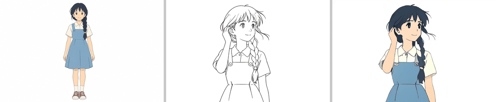
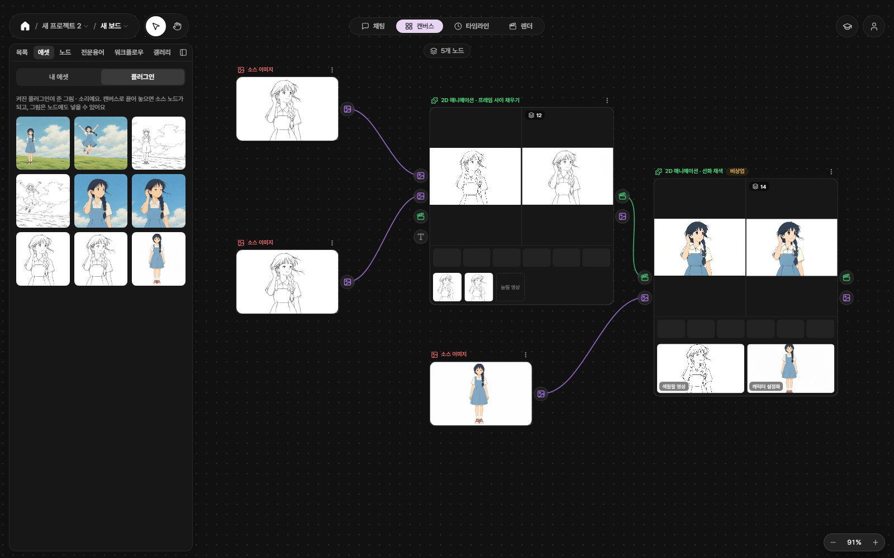

<!-- version: 1.0.1 | lastUpdated: 2026-10-31 -->
# 2D 애니메이션 팩 — 선화 채색 (AniDoc)

[English](README.en.md)

PromBoard 커뮤니티 플러그인입니다. 선화 영상(또는 컬러 영상)을 **캐릭터 설정화 한 장의 색으로 칠한 영상**으로 만듭니다. 공개 모델 [AniDoc](https://github.com/yihao-meng/AniDoc)(CVPR 2025)을 내 PC 에서 돌립니다.

2D 애니메이션 팩은 세 장으로 나뉩니다. 라이선스가 달라서 나눴습니다.

| 카드 | 하는 일 |
|---|---|
| [2D 애니메이션 팩 — 프레임 사이 채우기](https://github.com/promboard-app/anime2d) | 두 프레임 사이를 채워 영상으로, 영상의 프레임 늘리기 |
| **2D 애니메이션 팩 — 선화 채색** (이 저장소) | 선화 영상을 캐릭터 설정화의 색으로 칠하기 |
| [2D 애니메이션 팩 — 키프레임으로 채색 영상](https://github.com/promboard-app/anime2d-tooncomposer) | 키프레임 몇 장으로 채색된 영상 만들기(서버급) |

> 윈도우 · 리눅스 전용입니다(맥은 안 됩니다). 이 카드는 NVIDIA 그래픽카드가 있어야 돕니다.

왼쪽 캐릭터 설정화의 색으로 가운데 선화 영상을 칠한 결과(오른쪽)입니다. 가운데 선화 영상은 예제 선화 두 장을 팩 카드 '두 프레임 → 중간 프레임'으로 이은 14프레임이고, 그림은 모두 아래 예제 워크플로우를 앱에서 그대로 돌려 얻었습니다(시드 1).

## 이렇게 씁니다

1. PromBoard 앱 → 플러그인 매니저 → **커뮤니티 플러그인**에서 이 카드를 설치합니다. 라이선스 안내(비상업)를 읽고 체크해야 설치됩니다.
2. 코드가 든 플러그인이라 **제한 모드**를 끄고 플러그인을 켭니다.
3. 처음 실행할 때 실행 준비가 모델과 파이썬 패키지를 받습니다(한 번만, 아래 표).
4. 둘 중 하나로 시작합니다.
   - **예제로 해 보기**: 캔버스의 [워크플로우 불러오기] → 플러그인 칸의 「이어진 선화 두 장 → 중간 프레임 → 선화 채색」를 고릅니다. 왼쪽 패널 에셋 › 플러그인의 예제 카드를 소스 노드 위에 끌어 놓습니다(이어진 선화 시작 프레임 · 이어진 선화 끝 프레임 → 왼쪽 두 소스, 캐릭터 설정화 → 아래 소스). '프레임 사이 채우기' 노드 ▷, '선화 채색' 노드 ▷ 를 차례로 누릅니다. 이 워크플로우는 팩 카드 「프레임 사이 채우기」도 씁니다. 없으면 '누락된 플러그인 설치'가 받아 줍니다.
   - **내 선화 영상이 있으면**: 캔버스에 소스 영상 노드(선화 영상)와 소스 이미지 노드(캐릭터 설정화)를 놓고 **2D 애니메이션 · 선화 채색** 노드에 바로 이으면 됩니다. 팩 카드는 필요 없습니다.

예제 워크플로우를 돌린 앱 화면입니다. 왼쪽 패널이 예제 카드, 오른쪽 끝 노드가 이 카드입니다(머리의 '비상업' 알약).

## 넣는 것과 나오는 것

| | 내용 |
|---|---|
| 넣는 것 | 색칠할 영상(선화 영상 또는 컬러 영상) · 캐릭터 설정화 1장 |
| 나오는 것 | 칠한 영상(512×320 안에 맞춤, 입력 비율 · fps 그대로, 소리 없음)과 그 프레임(영상이 64프레임 이하일 때) |
| 받을 용량 | 모델 10.6GB + 파이썬 패키지(torch 포함, 설치하면 약 6.6GB). 처음 한 번 |
| 그래픽카드 메모리 | NVIDIA 8GB 이상. 12GB 카드에서 최고 6.6GB 를 썼고, 7GB 로 묶어도 돌았습니다. 16GB 보다 작으면 쉬는 부품을 컴퓨터 메모리로 내려 두고 돕니다 |
| 걸리는 시간 | 14프레임: 첫 실행 약 1분 30초(모델 읽기 포함), 다음부터 약 21초. 98프레임 약 3분, 240프레임 약 6분 50초 (RTX 4070 SUPER 12GB) |
| 길이 | 240프레임까지(24fps 영상이면 10초). 첫 14프레임을 칠한 뒤 이 PC 에서 시간 안에 못 끝날 것 같으면 바로 멈추고 알립니다 |

- AniDoc 은 한 번에 14프레임을 칠합니다. 긴 영상은 14프레임씩 나눠 칠하고 잇습니다. 이웃 묶음은 1프레임을 겹쳐 칠하고 그 프레임은 두 결과를 반씩 섞어, 묶음이 바뀌는 곳의 색 차이를 줄입니다. 그래도 그곳에서 작은 부분(예: 머리끈 · 어깨 그늘)의 색이 한두 프레임에 걸쳐 살짝 바뀔 수 있습니다.
- 가로 16:10(512×320)이 가장 잘 됩니다. 비율이 다른 영상은 흰 여백을 넣어 칠한 뒤 여백을 잘라 돌려줍니다.
- 캐릭터 설정화는 칠할 캐릭터가 정면으로 크게 보이는, 평면 채색 그림이 좋습니다. 선화와 설정화의 캐릭터가 같아야 색이 맞습니다.

### 설정

| 설정 | 선택지 | 뜻 |
|---|---|---|
| 색칠할 영상 종류 | 컬러 영상 (선화를 뽑아서 칠함) · 선화 영상 (그대로 칠함) | 컬러 영상(처음 값): 프레임마다 선화를 다시 뽑아 칠합니다. 선화 영상을 넣어도 됩니다. 선화 영상: 흰 바탕 검은 선 영상의 선을 그대로 써서 원래 선을 살립니다. 색이 있는 영상을 이걸로 칠하면 망가집니다 |
| 시드 | 정수 (-1 이면 매번 다르게) | 같은 시드 · 같은 입력이면 같은 결과. 시드에 따라 색이 꽤 달라집니다(땋은 머리 · 셔츠 색이 바뀌는 등). 마음에 안 들면 시드만 바꿔 다시 돌려 보세요 |

## 더 해 보기

- **더 길게**: 장면을 몇 컷으로 나눠 칠하고 렌더 탭에서 잇습니다.
- **더 매끄럽게**: 결과 영상을 팩 카드의 '영상 → 프레임 늘리기'에 이으면 fps 를 2~3배로 올립니다.
- **더 크게**: 결과가 512×320 이라 작습니다. 업스케일 플러그인(SeedVR2)으로 키웁니다.

## 이렇게 써도 되나요

| 카드 | 라이선스 | 판매 · 광고 · 유료 서비스(상업 이용) |
|---|---|---|
| 프레임 사이 채우기 | Apache-2.0 · MIT ([저장소](https://github.com/promboard-app/anime2d)) | 가능 (AnimeInterp 모델 파일은 라이선스 표기가 없음 — [그 저장소 README](https://github.com/promboard-app/anime2d)) |
| **선화 채색 (이 카드)** | 점 따라가기 CoTracker [CC-BY-NC-4.0](https://github.com/facebookresearch/co-tracker/blob/main/LICENSE.md) · 점 찾기 SuperPoint [Magic Leap 비상업 라이선스](https://github.com/magicleap/SuperPointPretrainedNetwork/blob/master/LICENSE) · 채색 모델 [Stability AI Community License](https://huggingface.co/stabilityai/stable-video-diffusion-img2vid-xt/blob/9e43909513c6714f1bc78bcb44d96e733cd242aa/LICENSE.md) | **불가** (비상업) |
| 키프레임으로 채색 영상 | 각 저장소 README | 각 저장소 README |

- 채색 노드를 한 번이라도 거친 결과물에는 PromBoard 가 '비상업' 표시를 붙입니다.
- 저장소의 LICENSE(Apache-2.0)는 PromBoard 코드와 AniDoc 코드 몫입니다. 담아 온 CoTracker · SuperPoint 코드와 받는 모델 때문에 플러그인 전체는 위 표대로 비상업입니다(파일별 라이선스는 [NOTICE.md](NOTICE.md)).
- 채색 모델 AniDoc 은 Stable Video Diffusion 을 고친 모델이라 Stability AI Community License 도 따릅니다(상업 이용은 연매출 100만 달러 미만만 · Stability AI 에 등록 · 'Powered by Stability AI' 표기 · 결과물로 다른 기반 생성 AI 모델을 만들거나 개선하지 않음). 위의 비상업 조건이 먼저 걸립니다.
- 이 표는 법률 조언이 아닙니다. 쓰기 전에 링크한 라이선스 원문을 읽어 주세요.

Powered by Stability AI.

## 들어 있는 것

- 예제 그림 3장(참조 이미지 카드): 이어진 선화 시작 프레임 · 이어진 선화 끝 프레임 · 캐릭터 설정화. AI(codex CLI `image_generation`)로 새 캐릭터를 새로 그렸고, ToonComposer 저장소 예제 그림 한 장을 그림체 참조로만 붙였습니다. 공개 데이터셋(ATD-12K · Sakuga-42M · AnimeRun)과 AniDoc 예제 그림은 다시 배포할 수 없어 넣지 않았습니다.
- 워크플로우 「이어진 선화 두 장 → 중간 프레임 → 선화 채색」: 이어진 선화 두 장 → (팩) 두 프레임 → 중간 프레임 12장 → 선화 채색(시드 1). 팩 카드 1.0.1 을 씁니다.

## 만드는 사람을 위한 메모

- 플러그인 id `promboard.anime2d-colorize`, 노드 id `colorize`, 입력 `video` · `reference`, 출력 `video` · `frames`, 설정 `source`(`color` · `line`) · `seed`.
- 파이썬 3.11(transformers 4.27 → tokenizers 0.13 이 3.11 까지), torch 는 앱이 고정한 2.8.0, diffusers 0.24.0. 잠금 파일은 `nodes/requirements-{win,linux}.txt`.
- 담아 온 상류 코드 · 고친 곳 · 받는 모델 목록은 [NOTICE.md](NOTICE.md).
- 순수 함수 시험(모델 없이): `python -m pytest tests`.
- README 움짤은 `docs/scripts/make_visuals.py` 로 실제 결과 영상에서 만듭니다.
